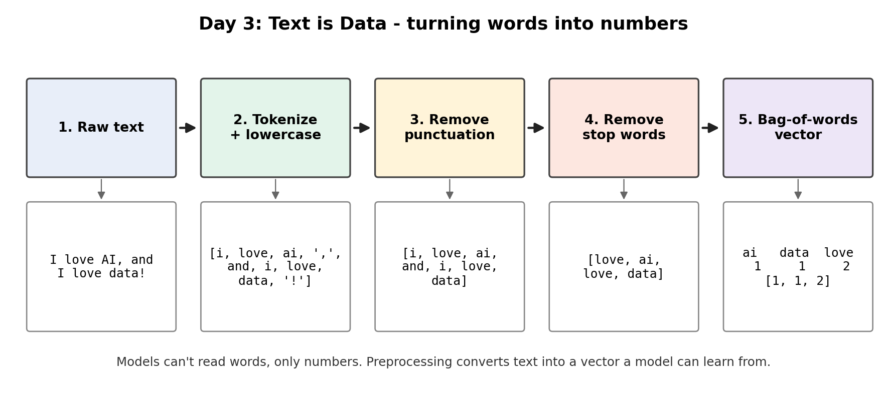

# Day 3: Text is Data - Turning Words into Numbers

Machines don't read words, they read numbers. Preprocessing is the first transformation that turns raw human language into something a model can learn from.

## What I did

I preprocessed text with NLTK and converted it to a bag-of-words representation.

1. **Tokenization**: lowercased the text and split it into tokens with `word_tokenize`.
2. **Punctuation removal**: dropped tokens that are punctuation (`. , ; !`).
3. **Stop-word removal**: removed common English words (the, is, and, to...) using NLTK's stop-word list.
4. **Bag-of-words**: counted how often each remaining word appears and turned the counts into a vector.
5. **Dataset**: repeated the steps on 4 sample sentences and saved a table of word counts as a CSV.

## Files

| File | Description |
|---|---|
| `Day3_Text_Preprocessing.ipynb` | Notebook with before/after output for every step |
| `preprocessed_dataset.csv` | Preprocessed text dataset, ready for ML input (one row per document, one column per word) |
| `day3_pipeline.png` | Diagram of the preprocessing pipeline |

## Example

Input: `I love AI, and I love data!`

| Step | Output |
|---|---|
| Tokenize | `['i', 'love', 'ai', ',', 'and', 'i', 'love', 'data', '!']` |
| Remove punctuation | `['i', 'love', 'ai', 'and', 'i', 'love', 'data']` |
| Remove stop words | `['love', 'ai', 'love', 'data']` |
| Bag-of-words | `ai: 1, data: 1, love: 2` -> `[1, 1, 2]` |

## What I learned

- Tokenization is better than splitting on spaces, because it separates punctuation from words.
- Stop-word removal shrinks the text and keeps the meaningful words. It can hurt in some tasks, for example removing "not" changes the meaning in sentiment analysis.
- NLTK splits contractions, so "don't" becomes `do` and `n't`.
- Bag-of-words loses word order and meaning: "dog bites man" and "man bites dog" get the same vector.

## Tools

Python, NLTK, pandas, Google Colab
