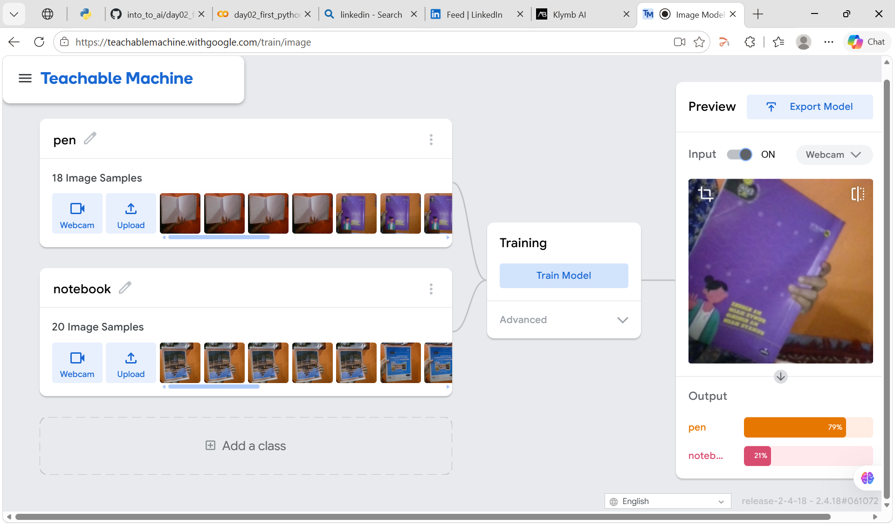
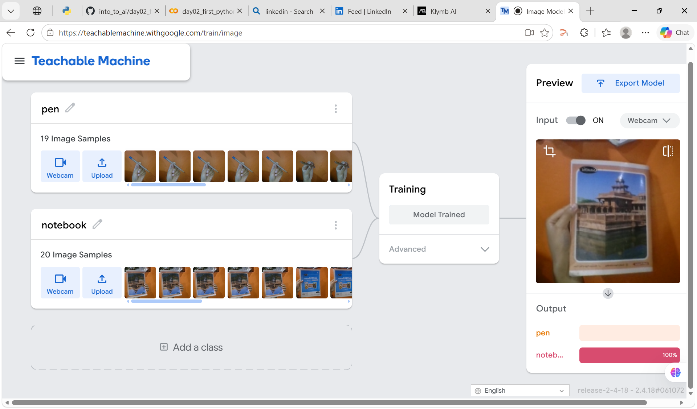
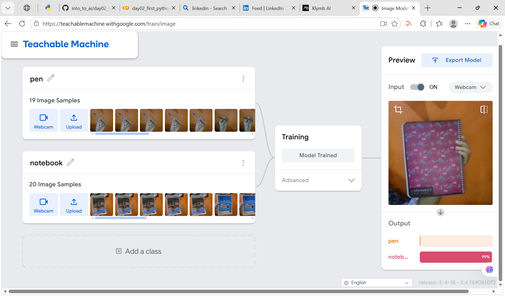

# Day 6: What is Machine Learning? Build an Intuition

## What I built
I used Google's Teachable Machine to train an image classifier with 2 classes: **pen** and **notebook**. I recorded about 20 webcam samples per class and tested the model live.

**Model link:** https://teachablemachine.withgoogle.com/models/90zhgRjSk/

## Experiments

### 1. Breaking it with wrong labels
On purpose, I put photos of notebooks into the "pen" class. When I tested with a notebook, the model said **79% pen**. After retraining on the bad data, it said **100% pen** for an open notebook. It became more confident in the wrong answer.

### 2. Fixing the data
I removed the wrong photos and recorded real pen photos for the pen class (19 samples). After retraining, the model said **100% notebook** for my notebook.

### 3. Testing a notebook it had never seen
I held up a different notebook (a pink spiral one) that was not in the training data. The model still predicted **99% notebook**.

## 3 Observations
1. **Wrong labels teach the model wrong answers.** With mislabeled data, the model confidently called a notebook a pen, and retraining made it even more sure (79% to 100%). The model trusts whatever labels it is given.
2. **Fixing the data fixed the model.** I did not change anything except the training photos, and the predictions became correct. Data quality matters as much as the model itself.
3. **Varied training photos help with new examples.** I trained with different notebooks, angles, and positions, and the model handled a brand new notebook with 98% confidence. More variety in the data helps it work on things it has not seen before.

## What I learned
Machine learning is not magic. A model learns patterns from the examples it is shown, so good, varied, correctly labeled data is what makes it work.
