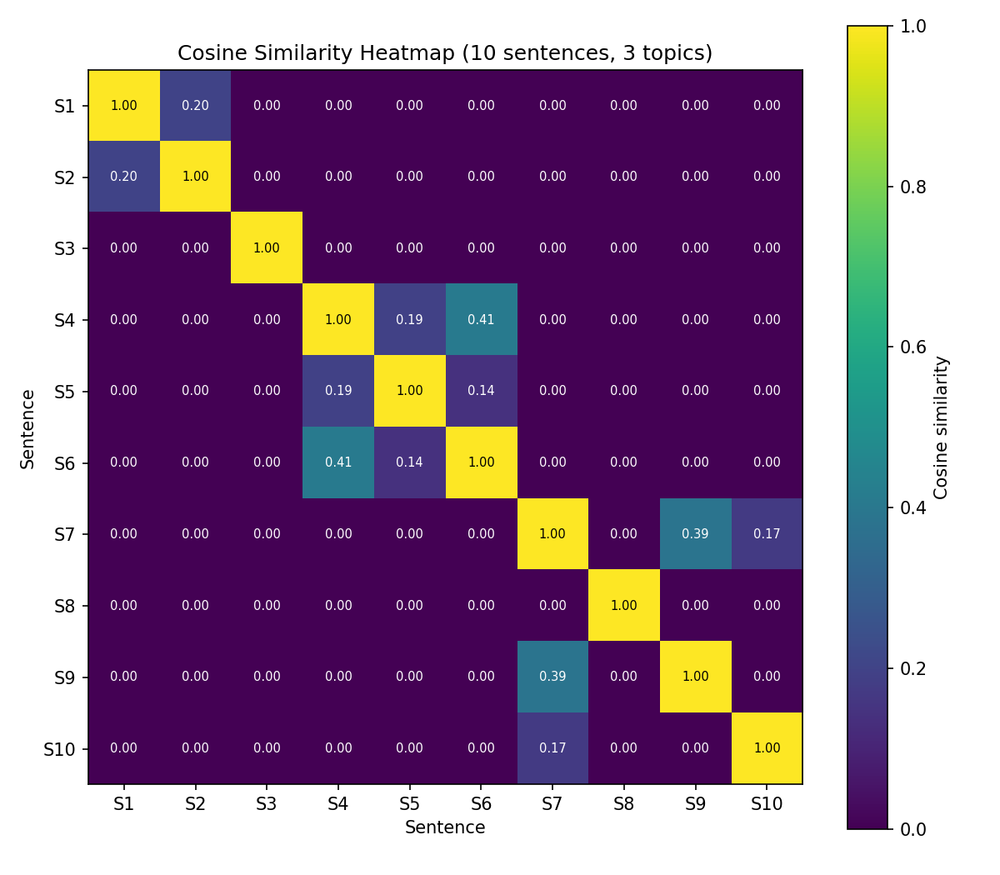

# Day 9: Vector Representation and Cosine Similarity

## What I built
A semantic similarity workflow using TF-IDF and cosine similarity.
- 10 sentences on 3 topics (animals, aviation, cooking) converted to TF-IDF vectors
- 10x10 cosine similarity matrix stored in NumPy
- find_similar(query, corpus, top_k) function, tested on several queries
- Heatmap of the similarity matrix showing the 3 topic clusters

## Heatmap

## Key findings
- Sentences on the same topic form bright clusters along the diagonal.
- "dog" vs "puppy" scores 0 with TF-IDF, because it only matches shared
  words, not meaning. Embeddings (Day 4) capture meaning and fix this.

## Why cosine similarity
It measures the angle between vectors, not the distance. A short and a long
text on the same topic have different lengths (big distance) but point in the
same direction (small angle), so cosine correctly says they are similar.

## Files
- Day9_Semantic_Similarity.ipynb: full code, outputs and written explanations
- day9_heatmap.png: the saved heatmap
