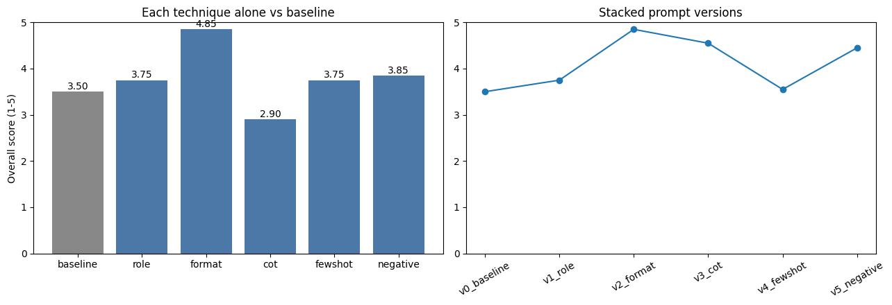

# Day 19: Systematic Prompt Engineering

Part of my 60-day AI challenge (Klymb.AI). I tested five prompt-engineering techniques on one task, measured each one, and built a grounding prompt that makes a RAG assistant refuse questions its context cannot answer.

## Task
Question answering over a small fictional knowledge base (Veridia Labs, 10 facts). Each of the 10 test questions gets the top-3 retrieved chunks as context (MiniLM embeddings + cosine similarity).

**Model:** Qwen2.5-1.5B-Instruct (local, Colab T4), greedy decoding so every run is deterministic.

## Method
1. **Rubric defined before running.** Accuracy (1-5) = share of required facts in the final answer. Format consistency (1-5) = one short sentence starting with `Answer:`.
2. **Baseline** plain prompt on 10 inputs.
3. **Five techniques, each alone:** role assignment, output format, chain-of-thought, few-shot, negative constraints.
4. **Stacked versions** v0-v5 with a prompt version dictionary (average score + one-line change description).
5. **Grounding prompt** for RAG, tested on 5 out-of-context questions.

## Results

| Technique (alone) | Accuracy | Format | Overall |
|---|---|---|---|
| Baseline | 4.60 | 2.40 | 3.50 |
| Role | 5.00 | 2.50 | 3.75 |
| **Format** | 4.80 | 4.90 | **4.85** |
| Chain-of-thought | 4.80 | 1.00 | 2.90 |
| Few-shot | 4.80 | 2.70 | 3.75 |
| Negative constraints | 4.80 | 2.90 | 3.85 |

Stacked versions: `v0` 3.50, `v1_role` 3.75, `v2_format` **4.85**, `v3_cot` 4.55, `v4_fewshot` 3.55, `v5_negative` 4.45.

### Findings
- **Format specification gave the largest gain (+1.35)**, but almost all of it is format consistency (+2.50); accuracy only +0.20. The baseline was already accurate (4.60) but inconsistent in shape.
- **Chain-of-thought hurt (-0.60)** for this extraction-style task: longer outputs, no final `Answer:` line.
- **Stacking few-shot on top dropped the score (4.55 -> 3.55).** Cause not diagnosed; plausible explanation: longer prompt and token limit, or imitation of the example style.
- With only 10 inputs, one question moves accuracy by 0.4, so small differences are not reliable.

### Grounding

| System | Strict | Lenient |
|---|---|---|
| No grounding | 0/5 | 3/5 |
| Grounding v1 | 3/5 | 4/5 |
| Grounding v2 (hardened) | 5/5 | 5/5 |
| Similarity gate (0.35) + v2 | 5/5 | 5/5 |

*Strict* = model used the exact refusal sentence. *Lenient* = refused in any wording.

- v1 leaked a general-knowledge answer (boiling point of water). v2 adds a rule that general knowledge is not answerable plus a refusal example.
- A **similarity gate** refuses in code when the best retrieved chunk scores below 0.35 (in-context 0.57-0.86 vs unrelated 0.08-0.24). It blocked 4/5; the near-topic question about Veridia's revenue (score 0.64) passed the gate and was refused by the prompt.
- **Over-refusal check:** 0/10 valid questions wrongly refused.

### Limitations
- A refusal check is not a correctness check: under the final system one answer was wrong (annual plan refund after 20 days: answered "No", correct is "Yes", since annual plans allow 30 days). The other 9 were correct.
- Keyword scoring is approximate; 10 inputs; one small model; greedy decoding.

## Files
- `Day19_Prompt_Engineering.ipynb`: full notebook with outputs
- `day19_score_comparison.png`: score charts
- `day19_results.json`, `day19_grounding.json`: saved numbers (download from the Colab file panel)

## Run it
Open the notebook in Google Colab, set the runtime to **T4 GPU**, then **Runtime -> Run all**. No API key needed.
