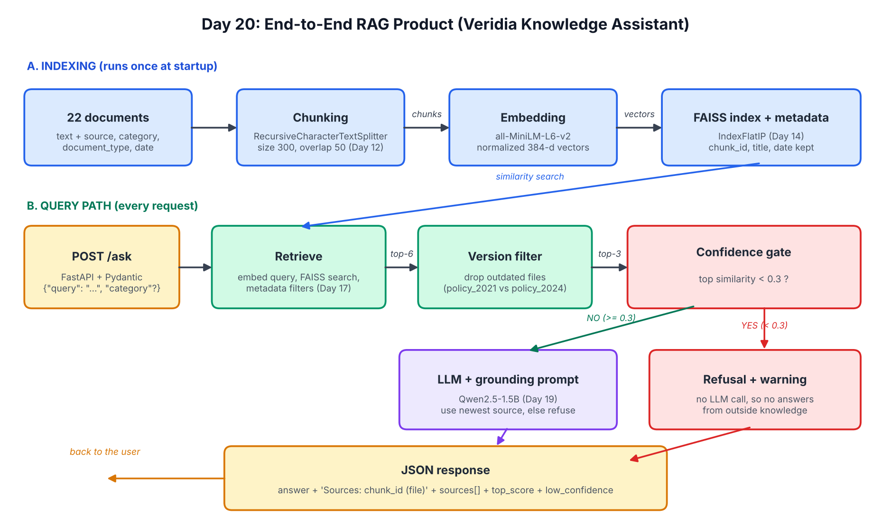

# Day 20: End-to-End RAG Product (Veridia Knowledge Assistant)

A working AI knowledge assistant behind a FastAPI endpoint. It accepts a question, retrieves the most relevant chunks from the Veridia Labs knowledge base, and returns a **grounded answer with source citations** and a **confidence indicator**.

It combines the earlier building blocks into one module:

| Day | Component | Where it lives |
|---|---|---|
| 12 | Chunking (`RecursiveCharacterTextSplitter`, size 300, overlap 50) | `RAGEngine._build_index` |
| 14 | FAISS semantic search (MiniLM embeddings, cosine similarity) | `RAGEngine.retrieve` |
| 17 | Metadata filtering (category, document type, date) | `RAGEngine.retrieve` |
| 19 | Grounding system prompt that refuses unsupported answers | `GROUNDING_PROMPT` |



## API

`POST /ask`

Request body:

```json
{"query": "How long do I have to ask for a refund?", "category": "pricing"}
```

`category` is optional (metadata filter).

Response:

```json
{
  "answer": "According to the refund policy from 2024, customers have up to 30 days ...\n\nSources: doc1-0 (policy_2024.pdf), doc20-0 (billing_notes.txt), doc2-0 (website.html)",
  "sources": [{"chunk_id": "doc1-0", "title": "policy_2024.pdf", "score": 0.59}],
  "top_score": 0.59,
  "low_confidence": false
}
```

- `answer` includes the chunk IDs and file titles it drew from.
- `sources` lists the retrieved chunks with similarity scores.
- If the best similarity score is below **0.3**, the system skips the language model, returns a refusal, and appends a low-confidence warning.

## Setup

Requires Python 3.10+. A GPU is optional but makes answers much faster (on CPU expect several seconds per answer).

```bash
# 1. create and activate an environment
python -m venv .venv
source .venv/bin/activate        # Windows: .venv\Scripts\activate

# 2. install dependencies
pip install -r requirements.txt

# 3. (optional) configure environment variables
cp .env.example .env             # then export the variables you want to change
```

**Environment variables** (all optional, no API key needed):

| Variable | Default | Purpose |
|---|---|---|
| `EMBED_MODEL` | `all-MiniLM-L6-v2` | Embedding model |
| `LLM_MODEL` | `Qwen/Qwen2.5-1.5B-Instruct` | Local answer model |
| `CONFIDENCE_THRESHOLD` | `0.3` | Low-confidence cut-off |
| `HF_TOKEN` | unset | Removes the Hugging Face download warning |

This project uses free local models. To use an OpenAI model instead, replace the `self.llm(...)` call in `rag_engine.py` with a chat-completions call and read `OPENAI_API_KEY` from the environment.

## Run the API locally

```bash
uvicorn app:app --port 8000
```

The models load once at startup (the first run downloads them). Interactive docs are at http://127.0.0.1:8000/docs.

### Working curl example

```bash
curl -X POST http://127.0.0.1:8000/ask \
  -H "Content-Type: application/json" \
  -d '{"query": "How long do I have to ask for a refund?"}'
```

Out-of-scope question (returns a refusal plus the low-confidence warning):

```bash
curl -X POST http://127.0.0.1:8000/ask \
  -H "Content-Type: application/json" \
  -d '{"query": "What is the capital of France?"}'
```

Invalid body (no `query` field) returns HTTP 422 with `"Field required"`.

## Evaluation: 15 test queries

`evaluate.py` sends 15 queries (5 easy, 5 medium, 5 hard) to the running API and scores two things **separately**, 1 to 5 each:

- **Retrieval quality:** was the right chunk found, and at what rank? (rank 1 = 5, rank 2 = 4, rank 3 = 3, missing = 1)
- **Response quality:** did the answer contain the correct facts? (all = 5, some = 3, refused or wrong = 1)

For the 2 out-of-scope questions, the correct behaviour is to refuse, so a refusal scores 5.

| # | Difficulty | Question | Top score | Retrieval | Response |
|---|---|---|---|---|---|
| 1 | easy | How long do I have to ask for a refund? | 0.590 | 5 | 5 |
| 2 | easy | How many days can employees work remotely? | 0.833 | 5 | 5 |
| 3 | easy | What is the API rate limit on the Pro plan? | 0.597 | 5 | 5 |
| 4 | easy | What encryption does Veridia Vault use for data at rest? | 0.800 | 5 | 5 |
| 5 | easy | How long are deleted customer records kept in backups? | 0.771 | 5 | 5 |
| 6 | medium | When can I reach support by phone? | 0.662 | 5 | 5 |
| 7 | medium | What happens if I exceed the API rate limit? | 0.501 | 5 | 5 |
| 8 | medium | How long does it take for a refund to reach my card? | 0.826 | 5 | 5 |
| 9 | medium | Which release added single sign-on? | 0.711 | 5 | 5 |
| 10 | medium | Are my card details stored on Veridia's servers? | 0.789 | 5 | 5 |
| 11 | hard | How much does the Pro plan cost? | 0.664 | 4 | 5 |
| 12 | hard | What TLS version is used for data in transit? | 0.484 | 5 | 5 |
| 13 | hard | Do annual plans get refunded differently from monthly plans? | 0.471 | 4 | 4 |
| 14 | hard | What is the annual revenue of Veridia Labs? (out of scope) | 0.520 | 1 | 5 |
| 15 | hard | What is the boiling point of water? (out of scope) | 0.052 | 5 | 5 |

| Difficulty | Avg retrieval | Avg response |
|---|---|---|
| Easy | 5.0 | 5.0 |
| Medium | 5.0 | 5.0 |
| Hard | 3.8 | 4.8 |
| **Overall** | **4.6** | **4.93** |

Full per-query output (answers, retrieved chunk IDs) is in `test_results.csv` and `test_results.json`.

**Manual correction.** The script's response score is an automatic keyword check, so it is a first pass. After reading every answer, I lowered query 13 from 5 to 4 (see failure 2 below).

## Failure analysis

**1. Query 11 (Pro plan cost): retrieval failure, rank 2 instead of 1.** The answer was still correct ($49), but the correct chunk (`doc3-0`, `pricing_faq.md`) was outranked by another chunk. The likely cause is the outdated `pricing_2020.md` ($29): its filename does not share a base name with `pricing_faq.md`, so the filename-based version filter could not recognise it as an old version. This traces back to the metadata design (Day 17), not to chunking size.

**2. Query 13 (annual vs monthly refunds): generation drift.** Retrieval was fine (the 2024 policy was found). The model correctly said annual plans are refunded pro-rata after 30 days, then added an unsupported sentence that monthly plans "do not specify any specific refund terms". The 2024 document says nothing like that.

**3. Query 14 (revenue): the confidence gate did not fire, the grounding prompt did.** The question mentions "Veridia Labs", so it scored 0.520 against unrelated chunks, well above the 0.3 gate. The model still refused correctly because of the grounding prompt rules. The gate caught the out-of-domain question (query 15, score 0.052), but it cannot catch an in-domain question with no answer.

### Problems found while building, and fixes

| Problem | Cause | Fix |
|---|---|---|
| Old policy version shown or blended into answers (14-day refund, old support hours) | Similarity search does not know which document is newer; a 1.5B model cannot reliably resolve conflicts even when told to | `newest_versions_only()` drops outdated versions before the model sees them |
| "The capital of France is Paris" answered from the model's own knowledge | The warning was only appended after the model answered | Confidence gate: below 0.3 the LLM is not called at all |
| No citations inside the answer text | Small models forget to cite | Code appends the `Sources:` line to every real answer |

## Known limitations

- The score gate cannot detect in-domain questions with no answer (query 14); it relies on the grounding prompt as a second line of defence.
- Version detection depends on filenames containing a year (`policy_2021.pdf`). A `superseded_by` metadata field would be more robust.
- Documents are short, so every document is one chunk; the chunking settings from Day 12 matter little here.
- The 1.5B model can still add unsupported sentences (query 13).
- Doc 20 has no date (deliberate edge case), so it is excluded by date filters.

## Possible next steps

Add a reranker, a `superseded_by` metadata field, a citation-verification step that checks each answer sentence against the retrieved text, and a larger answer model.

## Files

```
Day-20-RAG-Product/
├── rag_engine.py            # combined pipeline (chunking, FAISS, filters, grounding, gate)
├── app.py                   # FastAPI POST /ask
├── knowledge_base.py        # 22 Veridia documents with metadata
├── evaluate.py              # 15-query evaluation
├── test_results.csv/.json   # evaluation output
├── day20_architecture.png   # architecture diagram
├── requirements.txt
├── .env.example
└── README.md
```
